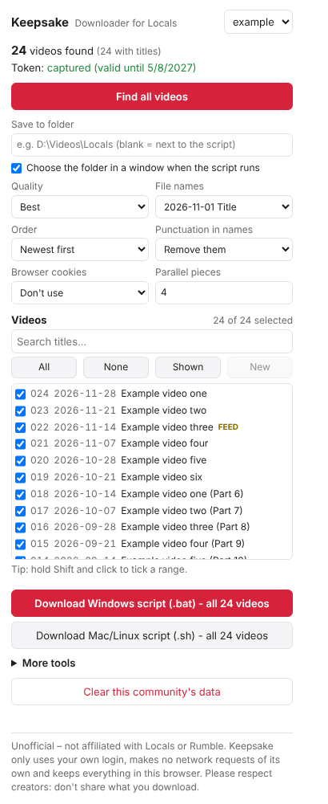

# Keepsake – Downloader for Locals


A browser extension for **Firefox and Chrome** that lets members of a [Locals](https://locals.com) community save that community's videos to their own computer for offline viewing.

> **Unofficial.** Keepsake is not affiliated with, endorsed by or supported by Locals or Rumble.
> It only works with videos your own account can already watch. Please respect creators: don't share or re-upload what you download.

Keepsake doesn't download anything itself and contains no content. It reads the video list from pages you already have open, then builds a download script for [yt-dlp](https://github.com/yt-dlp/yt-dlp), which runs on your own computer using your own access.

<p align="center"></p>

## Features

- **Find all videos:** scrolls a community's Content page (or Feed) to the end and collects every video with its title and date.
- **Pick what you want:** tick boxes, title search, Shift-click ranges, and **New** to select only videos added since your last download.
- **Tidy file names:** `2026-11-01 Patrick and The 3 Hour Fiasco.mp4`. The names stay the same, so re-running skips anything you already have.
- **One-click script:** a Windows `.bat` (or Mac/Linux `.sh`) that opens a folder picker, downloads everything, and ends with a summary such as *"352 done, 5 failed"*. Run it again to retry the failures.
- **Set-up help:** on Windows, the script offers to fetch yt-dlp and ffmpeg if they're missing.
- **Rename tool:** renames older downloads named by ID (`001 v_9c75….mp4`) to proper titles.
- **Private by design:** Keepsake makes no network requests of its own and has no server, analytics or tracking.

## What you need

- Firefox 142+ or a Chromium browser (Chrome, Edge, Brave)
- [yt-dlp](https://github.com/yt-dlp/yt-dlp/releases/latest) and [ffmpeg](https://github.com/BtbN/FFmpeg-Builds/releases/tag/latest)
  - **Windows:** nothing to install beforehand. The script offers to download both into its own folder, and uses existing copies if it finds them (for example after `winget install yt-dlp.yt-dlp` and `winget install Gyan.FFmpeg`).
  - **Mac:** `brew install yt-dlp ffmpeg`. **Linux:** use your package manager.

## Install

**Firefox:** download `keepsake.xpi` from the [latest release](../../releases/latest) and open it in Firefox. Releases are signed by Mozilla.

**Chrome / Edge / Brave:** download `keepsake-chrome.zip` from the latest release and unzip it. Then:
1. Go to `chrome://extensions` (or `edge://extensions`) and turn on **Developer mode**.
2. Click **Load unpacked** and choose the unzipped folder.

**For development:** in Firefox, open `about:debugging#/runtime/this-firefox`, choose **Load Temporary Add-on…** and select `extension/manifest.json`. In Chromium browsers, use **Load unpacked** on the `extension` folder.

## How to use

1. Log in to Locals and open the community's **Content** page.
2. Click the Keepsake icon, then **Find all videos**. The page scrolls itself to the end, and you can close the popup while it works. Run it on the **Feed** too to catch videos posted in ordinary posts. Those are tagged **FEED**.
3. **Play any one video for a few seconds**, so Keepsake can pick up your personal video token.
4. In the popup, tick the videos you want and choose the quality and the file-name style.
5. Click **Download Windows script (.bat)** (or **.sh** on Mac/Linux), save it next to `yt-dlp.exe` (or in any folder on Windows, where it can fetch yt-dlp itself), and double-click it.

> **The script contains your personal access token. Don't share it.**

## Privacy

- Keepsake makes **no network requests** of its own.
- Everything it finds (video IDs, titles, dates, your token) is kept in your browser's extension storage. **Clear this community's data** deletes it.
- **Export debug info** creates a file with the token removed, which you can attach to bug reports.

## Using it responsibly

Keepsake is for **personal offline viewing** of content you have paid for.

- **Don't share** downloaded videos, upload them elsewhere, or use them commercially.
- **Respect the law where you live.** In some countries, including the UK, copying content for private use isn't automatically covered by copyright exceptions.
- **Locals' terms may not allow automated tools.** Using Keepsake is at your own risk.

## How it works

See [docs/how-it-works.md](docs/how-it-works.md).

## Development

```
node test/run-tests.js                     # offline tests (page hook, script generator, safeguards)
python3 test/e2e/mock_locals_server.py &   # mock Locals page on port 8765
xvfb-run -a python3 test/e2e/run_e2e.py    # end-to-end test in Chromium (needs playwright)
npx web-ext lint --source-dir extension    # Firefox add-on linter
npx web-ext build --source-dir extension   # build a zip
```

## Roadmap

- [ ] Confirm the Windows set-up step and non-English characters on a real Windows PC
- [ ] Test on more communities, including livestream replays and audio posts
- [ ] Optional companion app that runs downloads directly (no script step)

See [CHANGELOG.md](CHANGELOG.md) for what each version added.

## Licence

MIT. See [LICENSE](LICENSE). "Locals" is a trademark of its owner and is used here only to describe what Keepsake works with.
