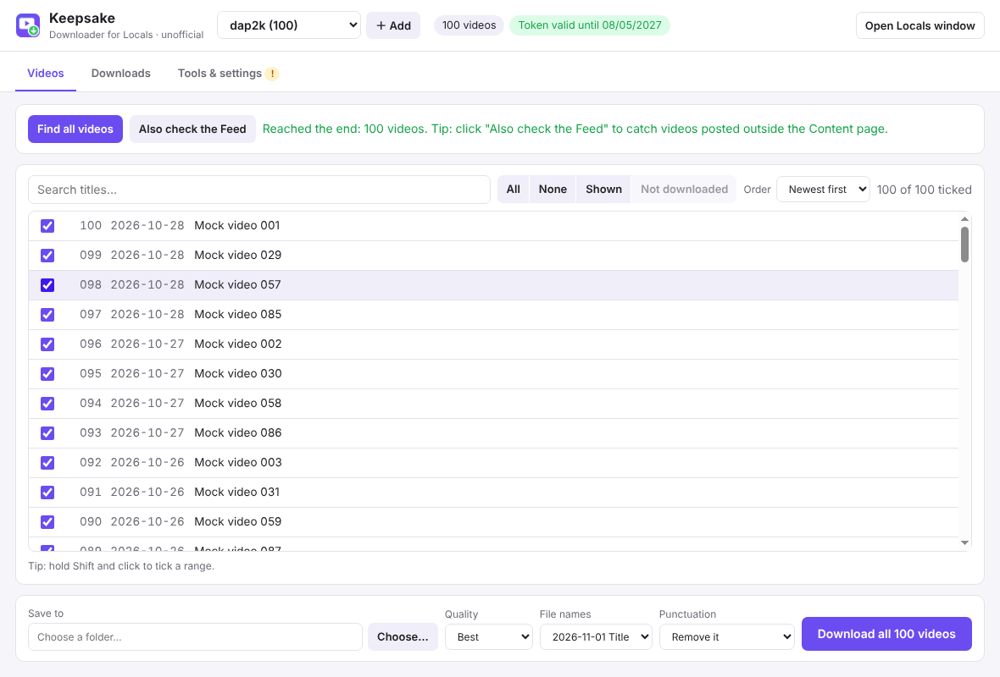

# Keepsake desktop app (beta)

A standalone Windows app that does everything the browser extension does, **and runs the downloads itself**: no script to save and run.

<p align="center"></p>

> **Unofficial.** Not affiliated with, endorsed by or supported by Locals or Rumble.
> For personal offline viewing of videos your own account can already watch. Please don't share what you download.

## Your password and your sign-in

- You sign in on **Locals' own sign-in page**, shown in the app's *Locals window*, exactly as in a browser. **Keepsake never sees, reads or stores your password.**
- **Signed up with Google (or Apple)?** Google and Apple don't allow signing in inside apps, and show *"Couldn't sign you in"*. Instead, sign in to Locals in **Firefox** as usual, then click **Use my Firefox sign-in** in Keepsake. Keepsake copies only the Locals sign-in (the locals.com cookies) from your Firefox profile, the same thing yt-dlp's "browser cookies" option does. It never sees your password or your Google account.
- After you sign in, the **session** (the cookies Locals sets) is kept only on your computer, in the app's data folder, just as a browser keeps it. **Sign out of Locals** in *Tools & settings* deletes it.
- Your personal **video token** (picked up when you play a video) is kept in the same place. It is sent only to Locals, when downloading.
- The app contacts only Locals (as your browser would) and GitHub (once, to fetch yt-dlp and ffmpeg). There is no server, analytics or tracking.

## Install (Windows 10/11)

1. Download `Keepsake-Setup-<version>.exe` from the [releases page](../../../releases).
2. Run it. Because the app isn't code-signed yet, Windows may show **"Windows protected your PC"**: click **More info → Run anyway**.
3. Choose where to install it (or keep the default) and finish.

## How to use

1. **＋ Add** your community: type its name (e.g. `example`) or paste its link.
2. The **Locals window** opens. **Sign in** there if you aren't already. If you sign in to Locals with Google, sign in in Firefox instead and click **Use my Firefox sign-in** (see above).
3. Back in Keepsake, click **Find all videos**. The Locals window scrolls through the Content page by itself. Click **Also check the Feed** to catch videos posted in ordinary posts.
4. In the Locals window, **play any video for a few seconds**, so that your access token is picked up. The top bar then shows *Token valid until …*.
5. Tick the videos you want, **Choose…** a folder, and click **Download**.
6. Follow progress on the **Downloads** tab. You can pause, resume and retry, and close the app at any time: unfinished downloads carry on from where they stopped when you click **Resume all**.

The first time you download, Keepsake fetches **yt-dlp** and **ffmpeg** from their official GitHub pages and checks them against their published checksums. Already have them? Use **Tools & settings → Use my own copies…**.

### Other tools (Tools & settings)

- **Rename old downloads…**: renames videos named by ID (e.g. `001 v_9c750134-….mp4`) to their titles.
- **Save Windows script / Mac/Linux script**: the same scripts as the extension, if you prefer to run downloads elsewhere.
- **Update yt-dlp**: fetches the newest yt-dlp (worth doing if downloads suddenly start failing).

### If something goes wrong

- **"Locals refused access (HTTP 403)"**: your token has probably expired. Play any video in the Locals window, then click **Retry failed** and **Resume all**.
- **"Couldn't sign you in" (Google):** use **Use my Firefox sign-in**, as described above.
- **No videos found:** make sure you are signed in, in the Locals window, and that you can see the videos there.
- **Save debug info** creates a file *without* your token, which you can attach to a bug report.

## Where things are kept

| What | Where (Windows) |
|---|---|
| Video lists, choices, download queue, token | `%APPDATA%\Keepsake\keepsake-data.json` |
| Locals sign-in session | `%APPDATA%\Keepsake\Partitions\locals\` |
| yt-dlp and ffmpeg | `%APPDATA%\Keepsake\tools\` |

Uninstalling leaves these in place. Delete the `%APPDATA%\Keepsake` folder to remove them.

## Development

The app is built with [Electron](https://www.electronjs.org/). It uses the same detection and naming code as the extension, from [`core/`](../core).

```
cd app
npm install
npm start                       # run the app
npm test                        # unit tests (queue, tools, storage, renaming)
xvfb-run -a npm run test:e2e    # end-to-end test against the mock Locals site (Linux; needs python3 and ffmpeg)
npm run dist                    # build the Windows installer (on Windows, or on Linux with Wine)
```

GitHub Actions runs the tests and builds the installer on every change (see `.github/workflows/app.yml`). Pushing a tag such as `app-v0.1.0` publishes the installer as a release.

**Planned (v0.2):** Mac and Linux builds, automatic updates, and a "check for new videos" option.
